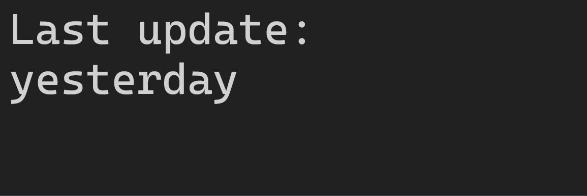

# last-update-text

[](https://www.npmjs.com/package/last-update-text)
[](https://bundlephobia.com/package/last-update-text)



Turns a timestamp into live-updating time-ago text, with customizable phrasing.

Ideal for showing users when content or data was last updated.

---


### General Usage Example:
```typescript
import { lastUpdateText } from "last-update-text"

lastUpdateText({
    since: Date.now(),
    onStatusChange: (newStatus) => { console.log(newStatus) }
})
```

### With React:
```typescript
import { useEffect, useState } from "react"
import { lastUpdateText } from "last-update-text"

export const LastUpdateText = ({ updatedAt }) => {
    const [statusText, setStatusText] = useState(() =>
        lastUpdateText({
            since: updatedAt,
            autoUpdate: false
        }).initialStatus
    )

    useEffect(() => {
        const { stop } = lastUpdateText({
            since: updatedAt,
            onStatusChange: setStatusText
        })
        return stop
    }, [updatedAt])

    return <p>{statusText}</p>
}
```

### `lastUpdateText` parameters:

| Parameter             | Description                                                                                                                                                    |
|-----------------------|----------------------------------------------------------------------------------------------------------------------------------------------------------------|
| * `since`             | Unix timestamp in milliseconds of when the event occurred.                                                                                                     |
| `onStatusChange`      | Callback invoked immediately with the initial status and whenever the text changes over time.                                                                  |
| `statusOptions`       | Custom labels or translations used to override the default status messages.                                                                                    |
| `countPlaceholder`    | Character or string replaced by the time number in plural templates. Defaults to `"#"`.                                                                        |
| `autoUpdate`          | Automatically updates the text over time via `onStatusChange`. Set to `false` to calculate only `initialStatus` without scheduling timers. Defaults to `true`. |

- `*` = not optional 

### `lastUpdateText` response:

| Parameter       | Description                                          |
|-----------------|------------------------------------------------------|
| `initialStatus` | String with the text of the first calculated status. |
| `stop`          | Cleanup function to stop future updates.             |

### Status Options and Rules:

| Status                | Default Text              | Interval Rule             |
|-----------------------|---------------------------|---------------------------|
| `justNow`             | "just now"                | 0s to 9s                  |
| `lessThanAMinuteAgo`  | "less than a minute ago"  | 10s to 59s                |
| `oneMinuteAgo`        | "1 minute ago"            | 1m to 1m_59s              |
| `xMinutesAgo`         | "`#` minutes ago"         | 2m to 59m_59s             |
| `oneHourAgo`          | "1 hour ago"              | 1h to 1h_59m_59s          |
| `xHoursAgo`           | "`#` hours ago"           | 2h to 23h_59m_59s         |
| `yesterday`           | "yesterday"               | 24h to 47h_59m_59s        |
| `xDaysAgo`            | "`#` days ago"            | 2d to 6d_23h_59m_59s      |
| `oneWeekAgo`          | "1 week ago"              | 1w to 1w_6d_23h_59m_59s   |
| `xWeeksAgo`           | "`#` weeks ago"           | 2w to 29d_23h_59m_59s     |
| `oneMonthAgo`         | "1 month ago"             | 30d to 59d_23h_59m_59s    |
| `xMonthsAgo`          | "`#` months ago"          | 60d to 364d_23h_59m_59s   |
| `moreThanAYearAgo`    | "more than a year ago"    | 365 days and above        |

- For simplicity, 1 month is treated as 30 days.

- `#` is rounded down to the nearest whole unit for that interval (minutes, hours, days, weeks, or months).


### Creating Custom Messages:
```typescript
lastUpdateText({
    since: Date.now(),
    onStatusChange: (newStatus) => { console.log(newStatus) },
    statusOptions: {
        justNow: "right now",
        xMinutesAgo: "Updated #min ago"
    }
})

// start            -> "right now"
// at 10 seconds    -> "less than a minute ago" (default)
// at 1 minute      -> "1 minute ago" (default)
// at each 1 minute -> "Updated 2min ago", "Updated 3min ago"...
// at 1 hour        -> "1 hour ago" (default)
// ...
```
- Override any `statusOptions` key to customize wording, create full messages, or translate labels into any language (unspecified keys fall back to the defaults).

- If you need to display a literal `#` in your messages, pass a custom character or token to `countPlaceholder` (e.g., `%` or `{count}`) and use it in your `statusOptions` templates.

## Tips
- **Avoid duplicate instances:** Call `lastUpdateText` once per timestamp and rely on `onStatusChange` for updates (it manages internal timers automatically without requiring manual polling or re-invocation).
- **Clean up on unmount:** Always call `stop()` when the UI element is unmounted or no longer needed to clear pending timeouts and prevent unnecessary background execution.

## Notes
- **100ms timer buffer:** Scheduled status checks include a 100ms buffer (`TIME_BUFFER`) to absorb runtime timer jitter and prevent premature or duplicate threshold triggers.
